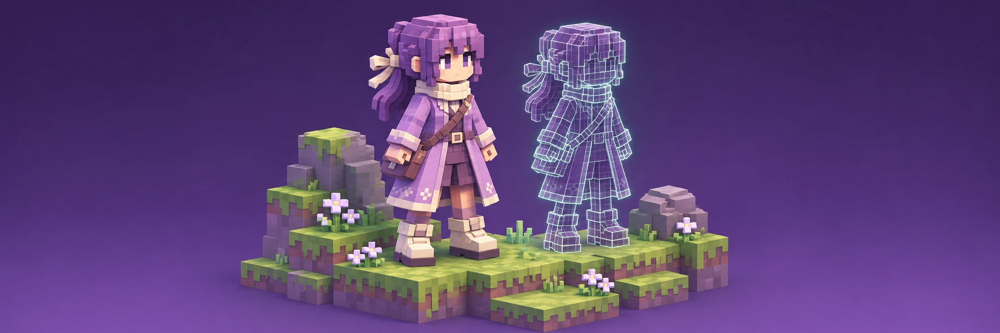

<h1 align="center">YsmBedrock</h1>

  在 Minecraft 基岩版 Windows 客户端穿戴 YSM 模型、切换外观、播放自定义动作。

  <strong><a href="https://github.com/XiaViolet/YsmBedrock/releases/tag/v0.29.44">0.29.44 预览版</a></strong> · Windows x64 · Minecraft 1.26.60.05

  <a href="https://github.com/XiaViolet/YsmBedrock/releases/download/v0.29.44/YsmBedrock-0.29.44.mcmod"><strong>下载 LeviLauncher · .mcmod</strong></a>
  &nbsp; · &nbsp;
  <a href="https://github.com/XiaViolet/YsmBedrock/releases/download/v0.29.44/YsmBedrock-0.29.44-BedrockBoot.zip"><strong>下载 BedrockBoot · .zip</strong></a>

## 快速开始

本版使用 [LeviLamina 26.60.9 客户端](https://github.com/LiteLDev/LeviLamina/releases/tag/v26.60.9)构建。手动安装包适用于 LeviLamina 26.60.7、26.60.8 或 26.60.9 客户端。通过 lip 安装时会使用 26.60.9。

先退出游戏，在启动器里选择对应的 Minecraft 实例，再导入上方对应的安装包。

| 启动器 | 导入位置 |
| --- | --- |
| **LeviLauncher** | 模组管理 → LeviLamina → 导入模组，选择 `.mcmod` |
| **BedrockBoot** | 模组管理 → LeviLamina → 导入模组，直接选择 `.zip` |

进入游戏后，按 **`Alt+Y`** 打开模型库。可以试用内置的酒狐和魔法酒狐，也可以导入原始 ZIP、受支持的 `.ysm` 或模型文件夹。选好外观后点击「穿戴此模型」，按 **`Z`** 打开动作转盘。

## 模型与联机

- **模型库**支持预览模型、切换贴图、收藏与调整作者配置。
- **动作转盘**用于播放模型自带的动作。
- **好友房间**支持在房主允许后同步模型与外观。房主和参与同步的玩家请使用同一版 YsmBedrock。

[功能手册](docs/项目功能手册.md) · [好友房间同步](docs/0.29.19-房间模型同步.md) · [服务器中继配置](docs/联机使用.md)

## 0.29.44 更新

修复 Arke 光影下第一人称低头时，快捷栏可见导致的角色地面投影闪烁。已在 Arke + Photon 1.4 环境复验。

[本版更新与下载](https://github.com/XiaViolet/YsmBedrock/releases/tag/v0.29.44) · [投影复验记录](docs/0.29.44-Arke投影.md) · [历史版本](https://github.com/XiaViolet/YsmBedrock/releases)

遇到问题可以提交 [GitHub Issue](https://github.com/XiaViolet/YsmBedrock/issues)。请附上游戏、LeviLamina、模组版本和复现步骤。光影问题也请注明 Arke 和光影包版本。

## 源码与署名

YsmBedrock 是 [Yes Steve Model](https://github.com/YesSteveModel/YesSteveModel) 的非官方基岩版移植。基岩版移植代码主要由 **OpenAI Codex** 编写，由 **XiaViolet** 维护。首页封面由 OpenAI 图像生成工具制作。

- [源码](src/) · [回归测试](tests/) · [构建与维护](docs/维护框架.md) · [Java 功能对照](docs/Java功能对照.md)
- [第三方声明](THIRD_PARTY_NOTICES.md) · [许可文件](licenses/) · [酒狐署名](licenses/wine-fox-source.json) · [魔法酒狐署名](licenses/magical-wine-fox-source.json)
