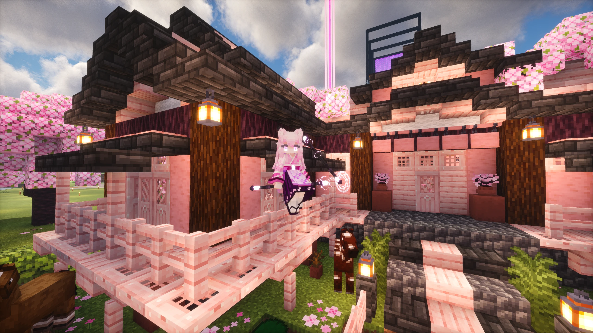

# YsmBedrock

[English](#english) · [简体中文](#chinese)

<a id="english"></a>

## English

YsmBedrock is an unofficial Windows client-side port of [Yes Steve Model](https://github.com/YesSteveModel/YesSteveModel) for Minecraft Bedrock Edition, built for [LeviLamina](https://github.com/LiteLDev/LeviLamina). It allows players to wear custom YSM models, change their appearance, and play custom emotes and animations.

This modified version is based on upstream YsmBedrock **0.29.44** and adds English localization, improved rendering performance, sharper UI elements, customizable themes, and automatic mod packaging.



### Requirements

- Windows x64
- Minecraft Bedrock Edition 1.26.60.05
- LeviLamina 26.60.9 Client (upstream also supports 26.60.7 and 26.60.8)

### Features

- Import and equip supported `.ysm` files, model ZIP archives, and model folders.
- Preview models, switch textures, manage favorites, and customize model settings.
- Play custom animations and emotes using the emote wheel.
- Synchronize models and appearances in friend rooms with the host's permission.
- English and Chinese interfaces that automatically follow Minecraft's language setting. Other languages fall back to English.
- Model-provided translations and offline English fallbacks for common model and emote labels. Custom author text without a translation may remain in its original language.
- Four menu themes: Midnight, Light, Forest, and Violet.
- Asynchronous model previews with configurable quality and frame rate up to 60 FPS, cached UI rendering, and reduced rendering overhead.
- Sharper text and menu icons with resolution-aware rendering.

### Installation and usage

1. Install LeviLamina Client in the corresponding Minecraft instance.
2. Import the built `.mcmod` through LeviLauncher's LeviLamina mod management page.
3. Launch Minecraft and enter a world.
4. Press `Alt+Y` to open the model library, select or import a model, and equip it.
5. Press `Z` to open the emote wheel.

### Build

Install [xmake](https://xmake.io/), Visual Studio 2022 Build Tools with C++ and the Windows SDK, and LLVM (`clang-cl`). Open an x64 developer terminal in the project directory and run:

```powershell
xmake f -p windows -a x64 -m release -y
xmake build -y YsmBedrock
```

With the automatic packaging changes and bundled assets installed, xmake generates the DLL and the importable mod archive:

```text
dist/YsmBedrock-0.29.44.mcmod
```

No original release ZIP or separate packaging command is required. The packaged legacy library supports older YSM v3 models.

### Credits and documentation

The original Bedrock port is maintained by [XiaViolet](https://github.com/XiaViolet/YsmBedrock), with most of the original port code written using OpenAI Codex. This modified version is not an official upstream release.

- [Feature guide](docs/项目功能手册.md) · [Room synchronization](docs/0.29.19-房间模型同步.md) · [Relay configuration](docs/联机使用.md)
- [Source](src/) · [Regression tests](tests/) · [Build and maintenance](docs/维护框架.md)
- [Third-party notices](THIRD_PARTY_NOTICES.md) · [Licenses](licenses/) · [Wine Fox credits](licenses/wine-fox-source.json) · [Magical Wine Fox credits](licenses/magical-wine-fox-source.json)

---

<a id="chinese"></a>

## 简体中文

> 以下为上游项目原始中文 README，保留原文。文中的下载链接指向上游原版，而非本修改版。
>
> The following is the original upstream Chinese README. Its download links point to the upstream release, not this modified build.

<h1 align="center">YsmBedrock</h1>

<p align="center">
  在 Minecraft 基岩版 Windows 客户端穿戴 YSM 模型、切换外观、播放自定义动作。
</p>

<p align="center">
  <strong><a href="https://github.com/XiaViolet/YsmBedrock/releases/tag/v0.29.44">0.29.44 预览版</a></strong> · Windows x64 · Minecraft 1.26.60.05
</p>

> [!IMPORTANT]
> 导入模组前，请先在对应的游戏实例中安装 **LeviLamina 客户端版**。本版支持 26.60.7、26.60.8 或 [26.60.9](https://github.com/LiteLDev/LeviLamina/releases/tag/v26.60.9)。

<p align="center">
  <a href="https://github.com/XiaViolet/YsmBedrock/releases/download/v0.29.44/YsmBedrock-0.29.44.mcmod"><strong>下载 LeviLauncher · .mcmod</strong></a>
  &nbsp; · &nbsp;
  <a href="https://github.com/XiaViolet/YsmBedrock/releases/download/v0.29.44/YsmBedrock-0.29.44-BedrockBoot.zip"><strong>下载 BedrockBoot · .zip</strong></a>
</p>


## 快速开始

本版使用 LeviLamina 26.60.9 客户端构建。通过 lip 安装时会使用 26.60.9。

先退出游戏，在启动器里选择对应的 Minecraft 实例，再导入上方对应的安装包。

| 启动器 | 导入位置 |
| --- | --- |
| **LeviLauncher** | 模组管理 → LeviLamina → 导入模组，选择 `.mcmod` |
| **BedrockBoot** | 模组管理 → LeviLamina → 导入模组，直接选择 `.zip` |

进入游戏后，按 **`Alt+Y`** 打开模型库。可以试用内置的酒狐和魔法酒狐，也可以导入原始 ZIP、受支持的 `.ysm` 或模型文件夹。选好外观后点击「穿戴此模型」，按 **`Z`** 打开动作转盘。

## 模型与联机

- **模型库**支持预览模型、切换贴图、收藏与调整作者配置。
- **动作转盘**用于播放模型自带的动作。
- **好友房间**支持在房主允许后同步模型与外观。房主和参与同步的玩家请使用同一版 YsmBedrock。

[功能手册](docs/项目功能手册.md) · [好友房间同步](docs/0.29.19-房间模型同步.md) · [服务器中继配置](docs/联机使用.md)

## 0.29.44 更新

修复 Arke 光影下第一人称低头时，快捷栏可见导致的角色地面投影闪烁。已在 Arke + Photon 1.4 环境复验。

[本版更新与下载](https://github.com/XiaViolet/YsmBedrock/releases/tag/v0.29.44) · [投影复验记录](docs/0.29.44-Arke投影.md) · [历史版本](https://github.com/XiaViolet/YsmBedrock/releases)

遇到问题可以提交 [GitHub Issue](https://github.com/XiaViolet/YsmBedrock/issues)。请附上游戏、LeviLamina、模组版本和复现步骤。光影问题也请注明 Arke 和光影包版本。

## 源码与署名

YsmBedrock 是 [Yes Steve Model](https://github.com/YesSteveModel/YesSteveModel) 的非官方基岩版移植。基岩版移植代码主要由 **OpenAI Codex** 编写，由 **XiaViolet** 维护。

- [源码](src/) · [回归测试](tests/) · [构建与维护](docs/维护框架.md) · [Java 功能对照](docs/Java功能对照.md)
- [第三方声明](THIRD_PARTY_NOTICES.md) · [许可文件](licenses/) · [酒狐署名](licenses/wine-fox-source.json) · [魔法酒狐署名](licenses/magical-wine-fox-source.json)
